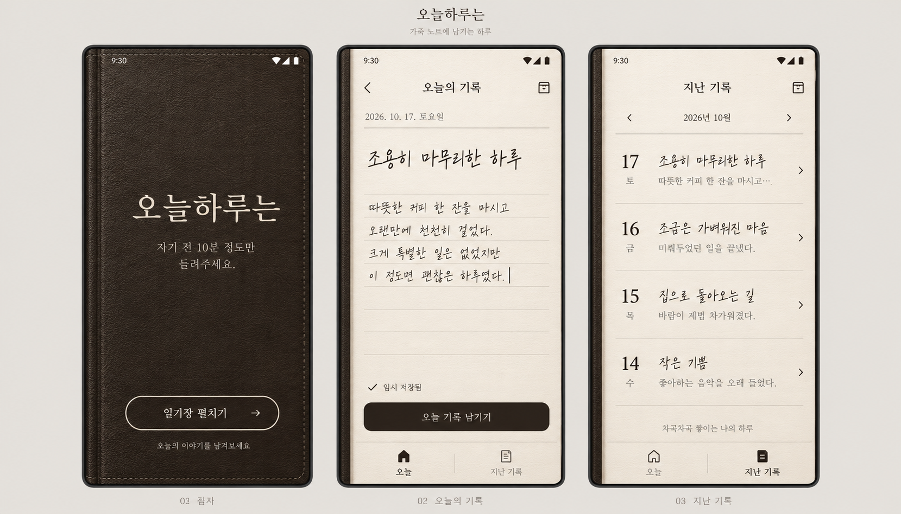

# 오늘하루는 디자인

사용자가 선택한 방향은 데이그램의 종이 느낌과 다욜의 노트 느낌을 결합한, 만년필로 쓰는 가죽 일기장입니다. 따뜻한 커피를 떠올리게 하는 색을 쓰되 화면은 모던한 모노톤으로 정리합니다.

## 화면

표지를 한 번 누르면 오늘의 페이지를 펼칩니다. 아이보리 종이에는 날짜와 선택적인 제목, 자유로운 본문이 놓입니다. 완료된 기록은 월별 목록에서 다시 읽고 수정하거나 삭제합니다. 날짜는 작성을 시작한 날로 유지하며, 작성 화면에서 이전 날짜를 선택할 수도 있습니다.

가죽은 표지 전체와 펼친 페이지의 왼쪽 가장자리에만 배치합니다. 본문 위의 질감은 약하게 유지합니다. 주된 동작만 짙은 잉크색 버튼으로 표시하고, 그 외에는 가는 선과 여백으로 구분합니다.

| 요소 | 값 |
| --- | --- |
| 가죽 / 주요 버튼 | `#302923` |
| 종이 | `#F6F1E7` |
| 본문 잉크 | `#302B26` |
| 보조 글자 | `#897F71` |
| 구분선 | `#D8CFC0` |
| 일기 본문 / 제목 | 나눔손글씨 펜 |
| 앱 이름 / 화면 제목 | 나눔명조 |

## 참고한 실제 앱

- [DayGram](https://play.google.com/store/apps/details?id=com.saltycrackers.daygram): 글에 집중하는 종이 화면과 짧은 기록.
- [DAYOL](https://dayol-e0395.web.app/): 실제 노트 표지와 속지를 펼치는 인상.
- [Five Minute Journal](https://play.google.com/store/apps/details?id=com.intelligentchange.fiveminutejournal): 따뜻한 색과 여백.

레퍼런스 앱의 소스·이미지·아이콘을 가져오지 않았습니다. 시안과 가죽 이미지는 이미지 생성 도구로 제작했으며, 실제 앱은 Android View로 구성합니다.

## 이미지 제작 기록

도구: Codex 내장 image_gen. 시안은 미리보기 이미지이며 앱 화면 자체가 아닙니다. 앱에 사용한 이미지는 `app/src/main/assets/textures/espresso-leather.png` 한 장입니다.

가죽 이미지 생성 프롬프트:

> Seamless square straight-on texture of premium very dark espresso brown leather notebook material, warm monochrome near #302923, fine matte leather grain, uniform neutral illumination. No border, seams, stitching, vignette, objects, text or logo. Full-bleed texture for a modern minimalist mobile notebook cover.

앱의 종이 결, 제본 그림자와 표지 바느질은 `NotebookSurface`에서 직접 그립니다.
