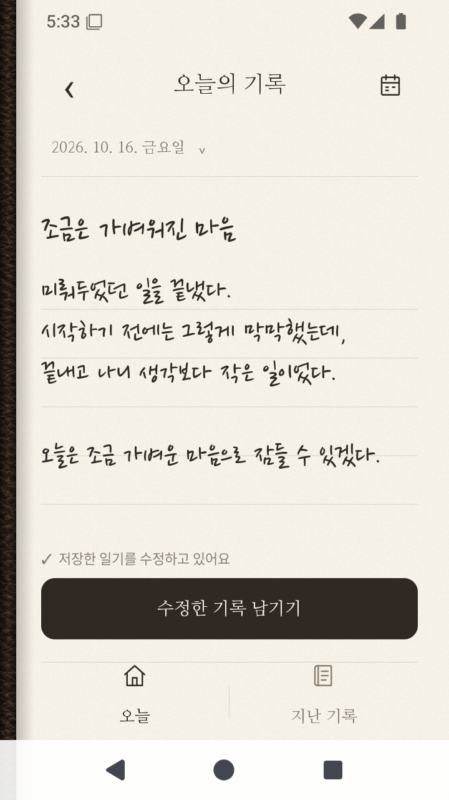
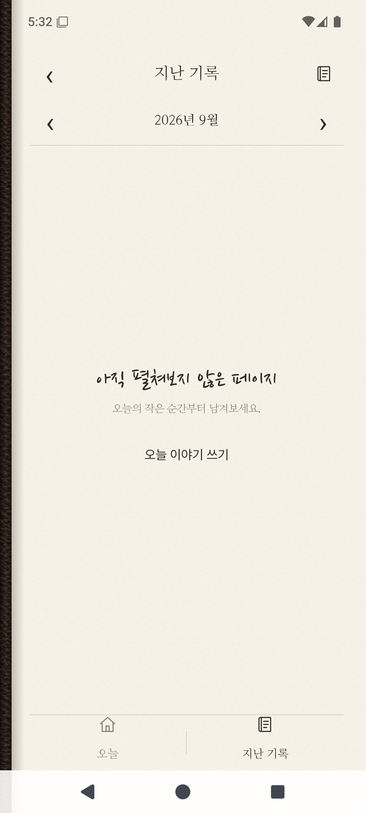

# 검증 기록

검증일은 **2026-10-17(KST)**입니다. 아래 내용은 실제 로컬 빌드와 PC 에뮬레이터에서 확인한 결과이며, 실제 휴대폰이나 GitHub Actions에서 실행한 결과는 아닙니다.

## 실행 환경

| 항목 | 환경 |
| --- | --- |
| 호스트 | Windows, AMD Ryzen 9 7945HX, 메모리 약 32GB |
| 가상화 | Windows Hypervisor Platform 가속 사용 가능 확인 |
| 가상 기기 | `TodayDiary_API35`, Pixel 6 프로필, Android 15 / API 35, x86_64 |
| 기본 화면 | 1080×2400, 420dpi |
| 작은 화면 확인 | 720×1280, 320dpi로 변경 후 기본값 복원 |
| JDK | Eclipse Temurin 17.0.20.1 |
| 빌드 | Gradle 8.11.1 / Android Gradle Plugin 8.9.2 |
| 한글 입력 | Fcitx5 Android 0.1.3 + Hangul 플러그인 |

Android Studio는 설치하지 않았습니다. JDK와 SDK는 프로젝트 밖의 사용자 도구 폴더에 설치했습니다. 전용 가상 기기만 생성·설정했고, 기존 과제와 기존 가상 기기는 수정하지 않았습니다.

## 빌드와 자동 검증

| 확인 | 결과 |
| --- | --- |
| `Scripts/Build.ps1` | Debug APK 생성 |
| `Scripts/Build.ps1 -Config Release` | 서명하지 않은 Release APK 생성 |
| Android Lint | 오류 0개, 경고 3개 |
| `Scripts/Build.ps1 -Test` | 기기 테스트 10개 통과 |
| `Scripts/Run.ps1 -SkipBuild` | 실행 중인 에뮬레이터 재사용, APK 설치·실행 |
| 에뮬레이터 종료 후 다시 실행 | 전용 가상 기기 부팅·앱 실행 확인 |

Lint 경고 세 개는 고정한 AndroidX 테스트 라이브러리의 새 버전 알림입니다. 앱의 API 호환성 오류는 해결했습니다. `android.overridePathCheck=true`에 대한 Gradle 안내도 출력됩니다. 한글이 포함된 프로젝트 경로에서 빌드를 허용하기 위한 설정입니다.

자동 검증은 저장 테스트 8개, 화면 이동 테스트 1개, 생명주기 테스트 1개로 구성했습니다. 저장 테스트는 별도 `verification.db`를 사용합니다. 생명주기 테스트는 특정 과거 날짜의 기록·초안을 보관했다가 시험 후 복구합니다. 현재 테스트를 실행하는 스크립트는 `adb install -r`과 instrumentation을 사용하며, 시험이 끝났다고 앱을 제거하지 않습니다.

검증한 항목은 한글·줄바꿈·이모지 보존, 데이터베이스 재열기, 완료된 일기와 수정 초안 분리, 같은 날짜의 기록 갱신, 날짜 기준 월별 정렬, 과거 초안 조회, 삭제, 제목 생략·특수문자, 빈 수정 초안 보존, 화면 이동, Activity 재생성 후 한글 복구·저장·수정입니다.

로컬 빌드·시험 로그는 생성되는 `Artifacts/verification-log.txt`, `Artifacts/release-build-log.txt`에 있습니다. 캐시와 실행 결과는 Git에 포함하지 않습니다.

## 직접 조작한 확인

실제 작성 화면에서 키보드로 영문 제목과 본문을 입력하고 자동 저장 이후 앱 프로세스를 강제 종료했습니다. 다시 표지를 열었을 때 **제목과 본문이 그대로 복구된 것을 UI 계층에서 확인**했습니다. 이 과정은 Activity 재생성 시험과 별도로 수행했습니다.

그 초안을 완료된 일기로 저장한 뒤 삭제 대화상자에서 취소하면 읽기 화면이 유지되고, 삭제를 확정하면 목록에서 사라지는 것을 확인했습니다. 시험용 글은 정리했고, 예시 일기 네 편을 남겨 두었습니다.

월을 이전으로 바꿔 빈 목록 안내를 확인하고 현재 달로 돌아왔습니다. 예시 일기를 열어 수정 화면에서 한글 본문이 표시되는 것을 확인했습니다. 기본 해상도와 720×1280의 작은 화면에서 작성 화면·저장 버튼이 표시됩니다. 키보드가 올라오면 하단 탐색은 숨기고 본문을 스크롤하며, 저장 버튼은 키보드 위에 남습니다.

전용 입력기의 화면 자판을 직접 눌러 두벌식으로 **‘오늘’이 조합되는 것을 확인**했습니다. 입력기 설정에서 Hangul을 추가했으며, 입력기 프로세스를 다시 시작한 뒤에도 English와 Hangul 목록이 유지됐습니다. 일반 영문 자판 위치를 사용하므로 화면 키캡이 영문이어도 Hangul 모드에서는 한글로 입력됩니다.

## 실제 화면

이 이미지는 에뮬레이터의 `screencap`으로 가져온 실제 실행 화면입니다. 디자인 시안과 구분하며, 시연용 예시 글만 사용했습니다.

## 검증하지 않은 범위

실제 Android 휴대폰, 모든 OS 버전, 제조사별 키보드, 태블릿·가로 화면, TalkBack, 저장 공간 부족의 실제 재현, 장기간 사용은 검증하지 않았습니다. 자동 저장 직전의 강제 종료까지 모든 입력이 보존된다고 보장하지 않습니다. 데이터베이스 파일을 별도 암호화하지 않습니다.

GitHub용 워크플로 파일은 준비했지만 원격 저장소를 생성하거나 push하지 않았으므로 GitHub Actions 실행을 완료했다고 표시하지 않습니다. Release APK는 개발용 Debug APK와 달리 서명되지 않았으며, 배포용 서명 검증을 수행하지 않았습니다.
