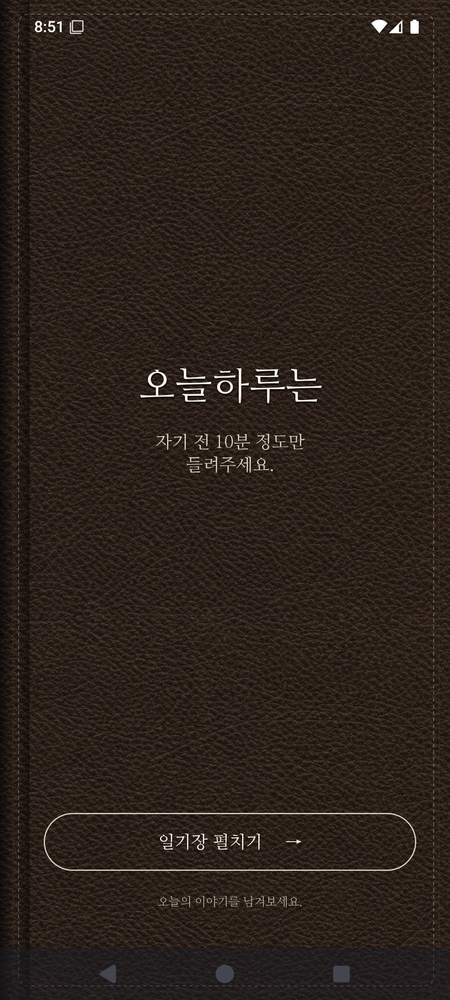

<h1 align="center">Dear Today</h1>

<p align="center">Java와 SQLite로 만든 Android 일기장 앱</p>

<p align="center">
  
  
  
</p>

<p align="center">
  
  
  
</p>

## Contents

- [프로젝트 소개](#프로젝트-소개)
- [일기 작성과 지난 기록](#일기-작성과-지난-기록)
- [일기와 초안의 분리 저장](#일기와-초안의-분리-저장)
- [검증 결과](#검증-결과)
- [빌드 및 실행](#빌드-및-실행)

## 프로젝트 소개

하루를 한두 줄로 남기는 Android 일기장입니다. 부경대학교 모바일 프로그래밍 수업에서 만든 앱을 1년 뒤 다시 손봤습니다. 저장 방식을 텍스트 파일에서 SQLite로 바꾸고, 가죽 표지를 열어 종이에 쓰는 흐름에 맞춰 화면을 새로 만들었습니다. 

- 날짜별 일기 작성, 월별 목록, 수정과 삭제
- 쓰던 글을 자동 저장하되, 이미 남긴 일기는 수정을 완료할 때만 갱신하는 초안 분리 저장
- 에뮬레이터 계측 테스트 10개로 저장·복구 동작 검증

## 일기 작성과 지난 기록

가죽 표지를 열면 오늘 날짜의 페이지가 나옵니다. 날짜마다 한 편을 남길 수 있고, 제목은 비워 둘 수 있습니다. 지난 기록은 월별 목록에서 날짜와 제목, 본문 일부로 찾습니다. 새 일기의 초안도 목록에 ‘작성 중’으로 표시되어 날짜가 지나도 이어 쓸 수 있습니다.

<p align="center">
  
  
</p>

저장한 일기를 열면 내용을 읽고 수정하거나 삭제할 수 있습니다. 지난 날짜에 새 일기를 쓰려면 작성 화면의 달력에서 날짜를 고릅니다.

## 일기와 초안의 분리 저장

이미 저장한 일기를 고칠 때 자동 저장이 원본을 덮어쓰면, 수정이 끝나기 전에 지난 기록이 바뀝니다. 완성한 일기는 `entries`, 작성 중인 글은 `drafts`에 나눠 저장했습니다. 두 테이블에서 날짜를 기본 키로 사용해 하루에 일기와 초안을 각각 한 편씩 관리합니다.

<p align="center">
  
</p>

| 동작 | 저장 방식 |
| --- | --- |
| 입력을 0.6초간 멈추거나 화면을 벗어남 | 변경한 글을 `drafts`에 저장합니다. 앱을 백그라운드로 보낼 때도 같은 처리를 합니다. |
| 작성 화면을 다시 엶 | 초안이 있으면 초안을 먼저 불러옵니다. |
| 기록 남기기를 누름 | `entries`에 일기를 쓰고 같은 날짜의 초안을 지우는 작업을 한 트랜잭션으로 처리합니다. |
| 일기를 삭제함 | 일기와 같은 날짜의 초안을 함께 지워 목록에서 사라지게 합니다. |

기록 남기기는 일기 저장과 초안 삭제를 한 트랜잭션으로 묶어, 둘 중 하나만 반영되는 경우가 없게 했습니다.

```java
db.beginTransaction();
try {
    db.execSQL("INSERT OR REPLACE INTO entries(date, title, body, sample) VALUES (?, ?, ?, 0)", ...);
    db.delete("drafts", "date = ?", new String[]{date.toString()});
    db.setTransactionSuccessful();
} finally {
    db.endTransaction();
}
```

날짜는 `YYYY-MM-DD`로 저장합니다. 선택한 달의 첫날부터 다음 달의 첫날 직전까지 조회하고, 완성된 일기가 없는 날짜의 초안만 월별 목록에 함께 표시합니다. [SQLite 저장 코드](app/src/main/java/com/jiwoo/todaydiary/DiaryStore.java)

## 검증 결과

Android 15 에뮬레이터에서 계측 테스트 10개가 통과했습니다. 초안 자동 저장 후 원본이 유지되는지, 일기를 완성하면 같은 날짜의 초안이 지워지는지, 화면 재생성 후 한글 초안을 이어 쓸 수 있는지 등을 확인했습니다. 자동 저장이 끝난 뒤 앱 프로세스를 종료하고 다시 열어 제목과 본문이 복구되는 것도 확인했습니다. [검증 기록](Docs/Verification.md)

## 빌드 및 실행

Windows x64와 인터넷 연결이 필요합니다. 에뮬레이터 가속을 위해 하드웨어 가상화와 Windows Hypervisor Platform을 켭니다.

1. 저장소 루트에서 JDK 17, Android SDK, 에뮬레이터를 설치합니다.

   ```powershell
   powershell -NoProfile -ExecutionPolicy Bypass -File .\Scripts\Setup.ps1 -WithEmulator
   ```

2. `Start.cmd`를 실행해 앱을 빌드하고 에뮬레이터에 설치·실행합니다.

한글을 입력하려면 에뮬레이터의 Fcitx5 앱에서 `Input Methods → + → Hangul`을 추가합니다. 키보드의 지구본 버튼으로 한영을 전환할 수 있습니다.
