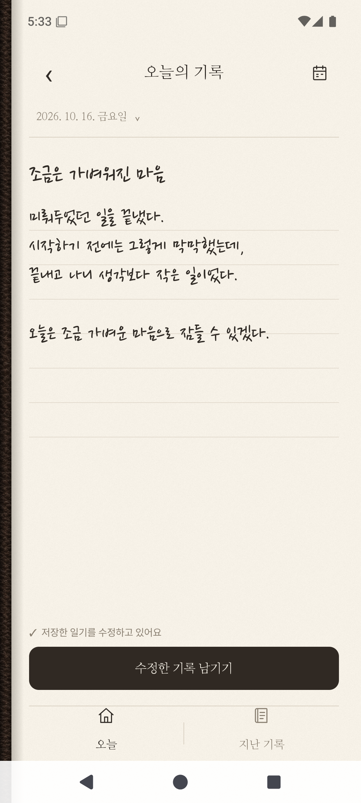
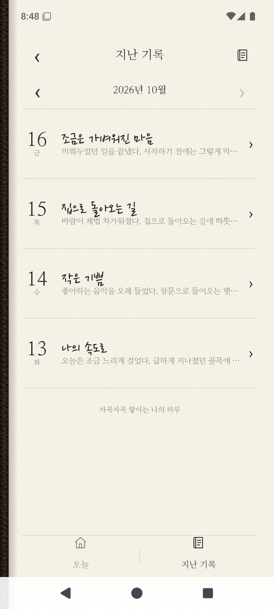
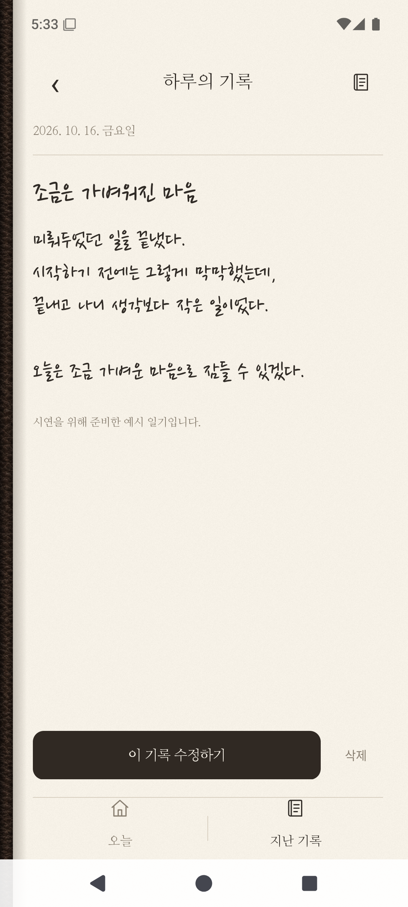

<div align="center">

# Dear Today

**간단한 일기장 어플리케이션**


<p align="center">



</p>

</div>

## Contents

- [프로젝트 소개](#프로젝트-소개)
- [개선](#개선)
- [앱 화면](#앱-화면)
- [검증](#검증)
- [빌드 및 실행](#빌드-및-실행)

<br>

## 프로젝트 소개

**Dear Today**(오늘하루는)는 잠들기 전에 오늘 있었던 일과 마음을 짧게 남기는 Android 일기장입니다. 하루를 길게 정리하지 않아도 한두 줄을 적고 마무리할 수 있는 앱으로 만들었습니다.

모바일 프로그래밍 강의에서 배운 내용을 실제 앱에 적용해 보기 위해 시작했습니다. Java와 모바일 프로그래밍을 처음 배우는 단계에서 Android Studio로 ‘나만의 일기장’을 만들었고, 이후 수업에서 배운 데이터베이스와 AI 도구를 활용해 기능과 화면을 보완했습니다.

<br>

## 개선

약 1년 전에 제작한 일기장을 바탕으로 2026년 10월 9일부터 개선을 시작했습니다. 기존에는 파일 입출력으로 일기를 텍스트 파일에 기록했는데, 데이터베이스 수업에서 배운 내용을 활용해 SQLite 데이터베이스에 저장하도록 바꿨습니다. AI의 도움을 받아 디자인을 다듬고, 테스트와 자체 QA를 진행해 부족했던 검증 절차도 보완했습니다.

<br>

## 앱 화면

가죽 표지를 열면 오늘의 일기를 쓰거나 저장한 글을 읽을 수 있습니다. 화면은 짙은 갈색 표지와 아이보리색 종이로 구성하고, 일기 제목과 본문에는 나눔손글씨 펜을 적용했습니다. Android의 기본 입력창을 사용하므로 손글씨처럼 보이는 글꼴로 키보드 입력을 할 수 있습니다.

일기는 날짜별로 한 편씩 저장합니다. 작성 중인 내용은 잠시 입력을 멈추면 초안으로 저장하고, 다시 열어 이어 쓸 수 있습니다. 저장한 일기를 수정할 때도 원본과 수정 중인 글을 따로 보관하며, 기록 남기기 버튼을 누르면 수정 내용으로 갱신합니다.

지난 기록은 월별 목록에서 날짜와 제목, 본문 일부를 확인할 수 있습니다. 과거 날짜의 일기도 작성할 수 있고, 목록에서 글을 열어 수정하거나 삭제할 수 있습니다.

<p align="center">


</p>

<br>

## 검증

기존 과제에서 부족했던 검증은 AI의 도움으로 테스트를 작성하고, 에뮬레이터에서 실제 동작을 확인하며 보완했습니다. 한글 입력과 줄바꿈이 저장되는지, 앱을 다시 열었을 때 글이 남아 있는지, 수정 중인 초안이 원래 일기를 덮어쓰지 않는지 등을 점검했습니다. 키보드가 올라왔을 때와 작은 화면에서도 작성과 저장을 할 수 있도록 화면을 다듬었습니다.


<br>

## 빌드 및 실행

Windows x64에서 실행합니다. PowerShell과 인터넷 연결이 필요하며, 에뮬레이터 가속을 위해 하드웨어 가상화와 Windows Hypervisor Platform이 활성화되어 있어야 합니다.

1. 프로젝트 폴더에서 처음 한 번 개발 도구를 설치합니다.

   ```powershell
   powershell -NoProfile -ExecutionPolicy Bypass -File .\Scripts\Setup.ps1 -WithEmulator
   ```

2. `Start.cmd`를 더블클릭하면 앱을 빌드하고 에뮬레이터에서 실행합니다.

처음 한글을 입력할 때는 에뮬레이터의 Fcitx5 앱에서 `Input Methods → + → Hangul`을 추가합니다. 이후 키보드의 지구본으로 한글과 영문을 전환할 수 있습니다.
