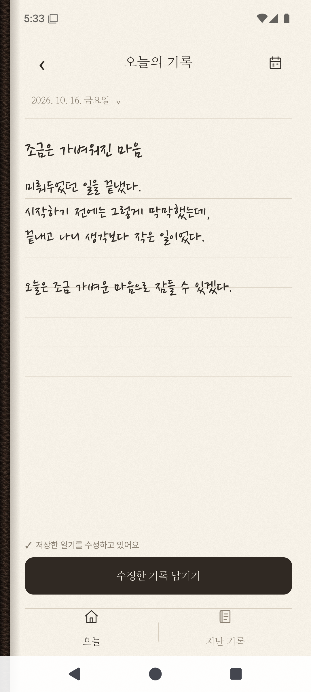
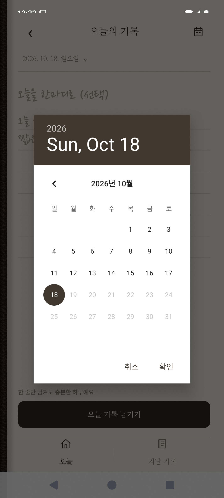

<h1 align="center">Dear Today</h1>

<p align="center">Java와 SQLite로 만든 Android 일기장 앱</p>

<p align="center">
  
  
  
</p>

<p align="center">
  
  
  
</p>

## Contents

* [프로젝트 소개](#프로젝트-소개)
* [일기 작성과 지난 기록](#일기-작성과-지난-기록)
* [일기와 초안의 분리 저장](#일기와-초안의-분리-저장)
* [빌드 및 실행](#빌드-및-실행)

## 프로젝트 소개

잠들기 전에 하루를 한두 줄로 남기는 Android 일기장입니다. 부경대학교 모바일 프로그래밍 수업에서 만든 앱을 1년 뒤 다시 손봤습니다. 처음에는 일기를 텍스트 파일로 저장했고, 이번에 SQLite 저장으로 바꾸면서 화면도 새로 만들었습니다.

## 일기 작성과 지난 기록

가죽 표지를 열면 오늘의 일기를 쓰는 화면이 나옵니다. 일기는 날짜마다 한 편이고, 제목은 비워 둘 수 있습니다. 쓰다가 앱을 나가도 내용이 남아 있어 나중에 이어 쓸 수 있습니다.

<p align="center">
  
  
</p>

월별 목록에서 날짜, 제목, 본문 앞부분을 보고 기록을 찾습니다. 저장된 글을 열면 왼쪽 화면처럼 읽거나 수정·삭제할 수 있습니다. 아직 쓰지 않은 날짜는 오른쪽 달력에서 골라 바로 작성할 수 있고, 쓰다 만 새 일기는 목록에 ‘작성 중’으로 표시됩니다.

## 일기와 초안의 분리 저장


자동 저장을 넣으면 한 가지 문제가 생깁니다. 이미 저장한 일기를 고치다가 앱을 나갔을 때, 고치던 내용을 자동으로 저장하면 원래 일기가 덮어써집니다. 사용자가 수정을 끝내지 않았는데도 원본이 사라지는 것입니다.

그래서 완성한 일기와 작성 중인 초안을 서로 다른 테이블에 둡니다. 두 테이블 모두 날짜를 기본 키로 써서, 하루에 일기 한 편과 초안 한 편만 존재합니다.

```sql
CREATE TABLE entries (date TEXT PRIMARY KEY, title TEXT NOT NULL, body TEXT NOT NULL, sample INTEGER NOT NULL DEFAULT 0)
CREATE TABLE drafts  (date TEXT PRIMARY KEY, title TEXT NOT NULL, body TEXT NOT NULL)
```

입력이 0.6초 동안 멈추거나, 다른 화면으로 이동하거나, 앱이 백그라운드로 가면 작성 중인 내용을 `drafts`에 저장합니다. `entries`의 원본은 그대로 남습니다. 작성 화면은 초안이 있으면 초안을, 없으면 원본을 불러오므로 다시 열었을 때 고치던 내용이 이어집니다. 위 화면처럼 원본을 수정하는 중이라는 문구도 이 상태로 판단해 표시합니다.

'기록 남기기'를 누를 때 비로소 초안이 일기가 됩니다. `entries`에 쓰는 일과 `drafts`를 지우는 일을 하나의 트랜잭션으로 묶어, 둘 중 하나만 반영되는 경우가 없게 했습니다.

```java
db.beginTransaction();
try {
    db.execSQL("INSERT OR REPLACE INTO entries(date, title, body, sample) VALUES (?, ?, ?, 0)", ...);
    db.delete("drafts", "date = ?", new String[]{date.toString()});
    db.setTransactionSuccessful();
} finally {
    db.endTransaction();
}
```

날짜를 `2026-10-16` 형식의 문자열로 저장하므로 문자열 비교가 곧 날짜 비교입니다. 월별 목록은 `date >= '2026-10-01' AND date < '2026-11-01'`로 한 달을 잘라 가져오고, 저장하지 않은 초안 중 같은 날짜의 일기가 없는 것도 '작성 중'으로 함께 보여 줍니다. 자정을 넘겨 쓰다 만 글도 목록에서 찾을 수 있습니다. 일기를 삭제할 때는 같은 날짜의 일기와 초안을 함께 지워 목록에 초안이 다시 나타나지 않게 했습니다. [저장 코드](app/src/main/java/com/jiwoo/todaydiary/DiaryStore.java)

이 동작은 에뮬레이터에서 실행하는 계측 테스트로 확인합니다. 초안을 저장해도 원본이 바뀌지 않는지, 완성하면 초안이 지워지고 그날의 일기가 하나만 남는지, 화면을 다시 만들어도(`Activity` 재생성) 한글 초안이 유지되는지, 제목에 `/`, `:`, `?` 같은 문자가 있어도 저장되는지 등 10개의 테스트가 `DiaryStoreTest`, `DiaryLifecycleTest`, `NotebookUiTest`에 있습니다.

## 빌드 및 실행

Windows x64에서 PowerShell 스크립트로 개발 도구 설치부터 에뮬레이터 실행까지 처리합니다. 인터넷 연결이 필요하고, 에뮬레이터 가속을 위해 하드웨어 가상화와 Windows Hypervisor Platform이 켜져 있어야 합니다.

1. 처음 한 번 JDK, Android SDK, 에뮬레이터를 설치합니다.

   ```powershell
   powershell -NoProfile -ExecutionPolicy Bypass -File .\Scripts\Setup.ps1 -WithEmulator
   ```

2. `Start.cmd`를 실행하면 앱을 빌드해 에뮬레이터에 설치하고 실행합니다.

에뮬레이터에서 한글을 입력하려면 Fcitx5 앱에서 `Input Methods → + → Hangul`을 추가하고, 키보드의 지구본 버튼으로 한영을 전환합니다.
