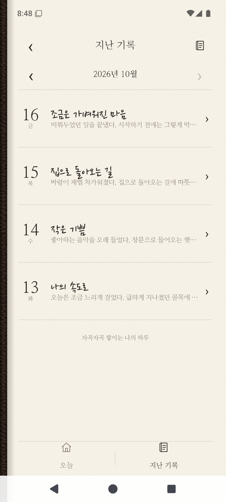
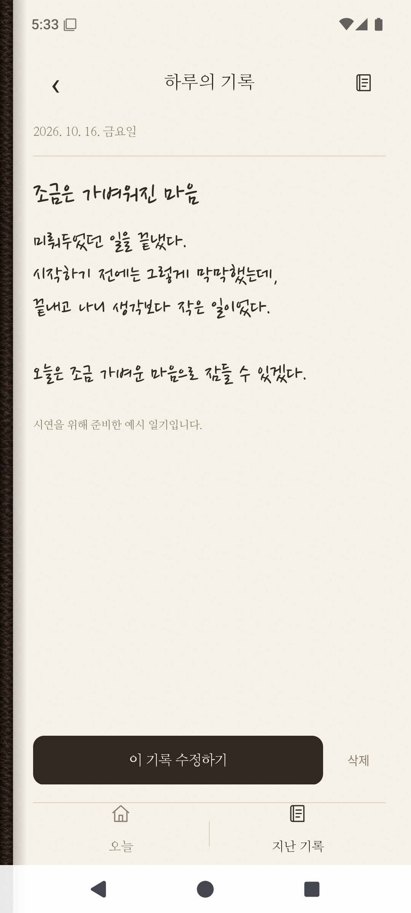

<h1 align="center">Dear Today</h1>

<p align="center">Java와 SQLite로 만든 Android 일기장 앱</p>

<p align="center">
  
  
  
</p>

<p align="center">



</p>

## Contents

- [프로젝트 소개](#프로젝트-소개)
- [일기와 초안 저장](#일기와-초안-저장)
- [빌드 및 실행](#빌드-및-실행)

## 프로젝트 소개

Dear Today(오늘하루는)는 날짜별로 한 편씩 글을 남기는 Android 일기장입니다. 가죽 표지를 열어 오늘의 글을 쓰거나 달력에서 지난 날짜를 고를 수 있습니다. 월별 목록에는 날짜와 제목, 본문 일부가 표시됩니다.

<p align="center">


</p>

목록에서 일기를 열면 글 전체를 읽거나 수정할 수 있습니다. 작성 도중 앱을 닫아도 다음에 같은 날짜를 열면 초안에서 이어 씁니다.

## 일기와 초안 저장

<p align="center">


</p>

이미 저장한 일기를 고칠 때는 편집을 중단해도 마지막으로 확정한 글이 남아 있어야 합니다. SQLite에는 일기와 초안을 별도 테이블로 두고, 두 테이블 모두 날짜를 기본 키로 사용합니다. 입력을 잠시 멈추면 그날의 초안만 갱신합니다.

‘기록 남기기’를 누르면 같은 날짜의 일기를 새 내용으로 저장하고 초안을 지웁니다. 두 변경을 한 트랜잭션으로 묶어 일기 저장과 초안 삭제가 함께 반영됩니다.

## 빌드 및 실행

Windows x64에서 실행합니다. PowerShell과 인터넷 연결이 필요하며, 에뮬레이터 가속을 위해 하드웨어 가상화와 Windows Hypervisor Platform이 활성화되어 있어야 합니다.

1. 프로젝트 폴더에서 처음 한 번 개발 도구를 설치합니다.

   ```powershell
   powershell -NoProfile -ExecutionPolicy Bypass -File .\Scripts\Setup.ps1 -WithEmulator
   ```

2. `Start.cmd`를 더블클릭하면 앱을 빌드하고 에뮬레이터에서 실행합니다.

처음 한글을 입력할 때는 에뮬레이터의 Fcitx5 앱에서 `Input Methods → + → Hangul`을 추가합니다. 이후 키보드의 지구본으로 한글과 영문을 전환할 수 있습니다.
